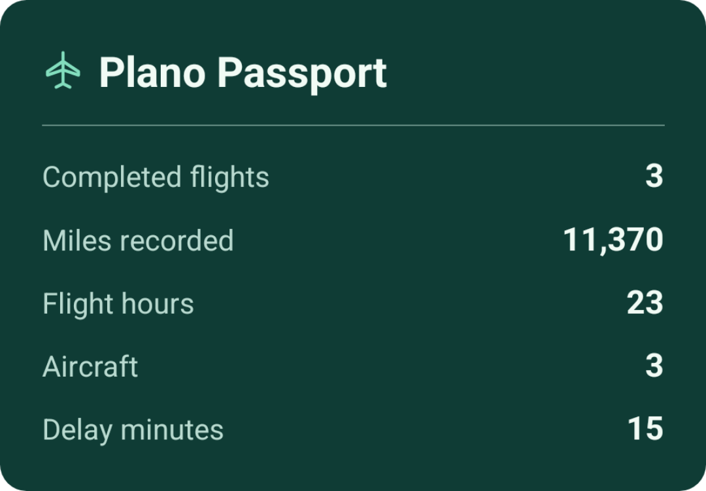

# Plano

Plano is a self-hosted flight tracker with an Expo mobile client and a Go backend. It keeps a flight's status, inbound aircraft, telemetry and travel history together, without paid tiers.

```sh
docker compose up --build --wait
curl --fail http://localhost:8080/healthz
```

Demo mode starts with synthetic flights and requires no credentials. Search for `UA123` or `UA456` by date. Use the mobile app's server setting to connect to your own HTTPS origin.

- [Self-hosting and credentials](docs/SELF_HOSTING.md)
- [Architecture and Flighty evidence](ARCHITECTURE.md)
- [Mobile app](mobile/)

This Passport card was exported through Android's normal share sheet in a release-emulator check. Its totals come from three synthetic, manually logged flights.



Run backend checks with Go 1.26 and a C compiler using `CGO_ENABLED=1 go test ./...`.

Run `bash deploy/verify-demo.sh` with Docker Compose and `jq` to check a
fresh demo deployment, including data persistence after container recreation.
It uses a temporary Compose project and loopback port. The [verification
workflow](.github/workflows/verify.yml) also checks the mobile JavaScript
bundles, builds an Android preview, and compiles the iOS simulator app and Live
Activity extension.
